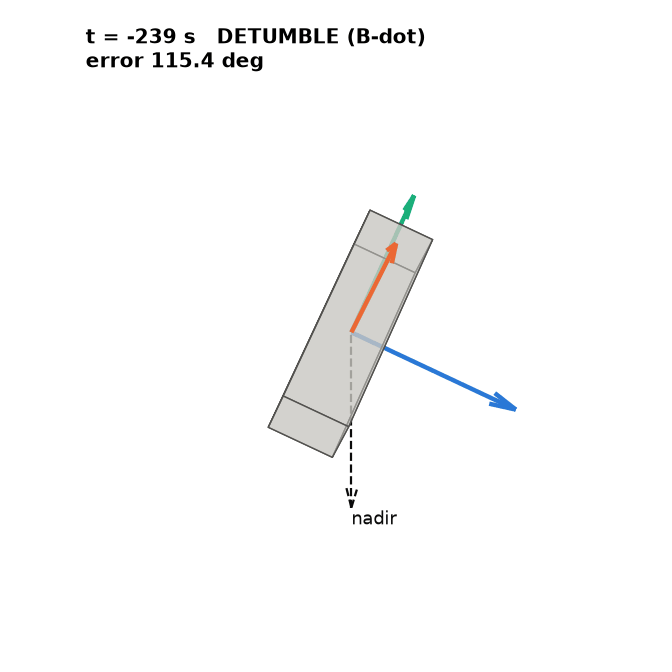
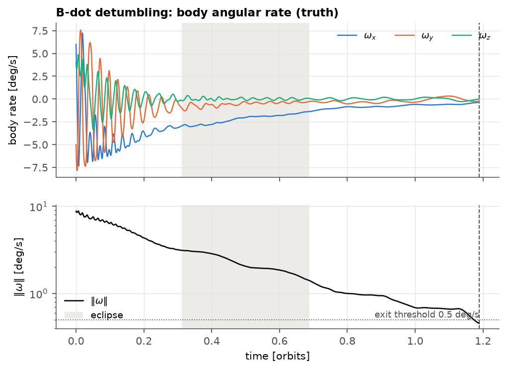
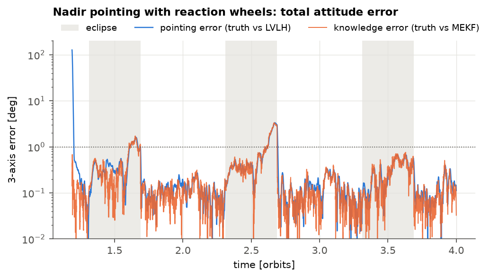
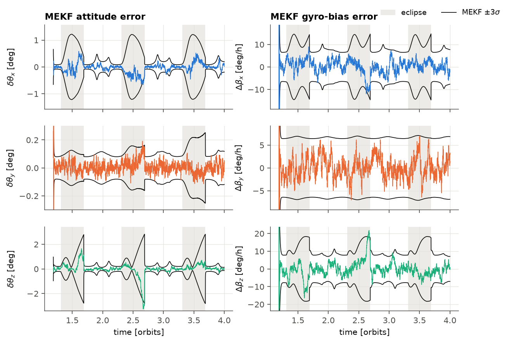
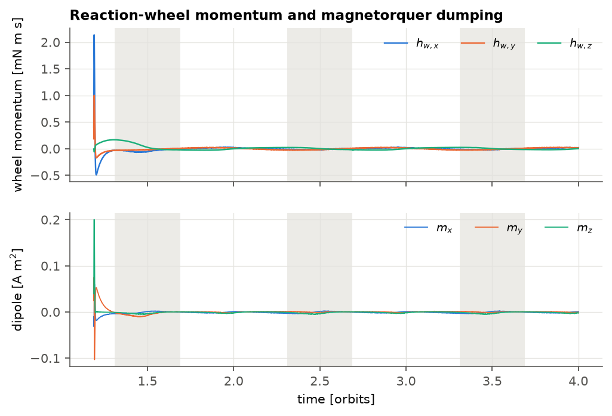
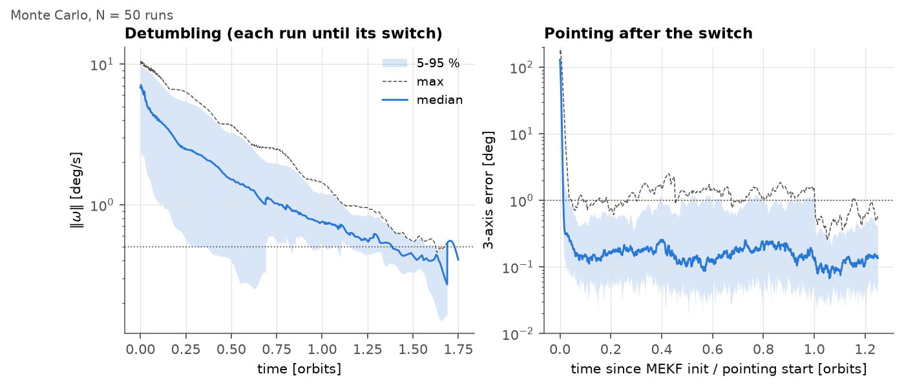

# tumble-to-point

<p align="center"></p>

A 3U CubeSat attitude simulator that takes the spacecraft from a 10 deg/s tumble to nadir pointing: B-dot detumbling with magnetorquers, TRIAD initialisation, a multiplicative EKF with gyro-bias estimation, and quaternion-feedback PD on reaction wheels with magnetic momentum dumping. About 1100 lines of NumPy/SciPy. In the last orbit of the nominal run the pointing error is 0.55 deg at p95 (0.32 deg in sunlight), and every number in this README comes from a test or a script in the repo.

<!-- TODO(Tommaso): dictate 3-4 lines in your own words -->

## Quick start

```bash
python -m venv .venv && source .venv/bin/activate
pip install -e ".[dev]"
pytest -s                          # ~1 min, prints the numbers
python scripts/run_mission.py      # nominal 4-orbit mission -> docs/figures, docs/results.json
python scripts/monte_carlo.py 50   # sequential Monte Carlo -> docs/monte_carlo.json (~8 min)
python scripts/monte_carlo.py --plot-only   # redraw from results/mc_runs.npz
```

With `pip install -e ".[igrf]"` and `SimConfig(field_model="igrf")` the truth flies through the full IGRF-14 field while the on-board model stays a dipole, which is useful for studying model mismatch.

The truth model (rigid body, wheels, orbit, environment) is integrated with RK4 at 4 Hz. Sensors and flight software run at 1 Hz, as on most CubeSat OBCs. `DETUMBLE` runs B-dot until the gyro-measured rate stays below 0.5 deg/s for 120 s and the Sun is visible; TRIAD then seeds the MEKF and the spacecraft switches to `POINTING` (nadir/LVLH). With no Sun there is no switch, because TRIAD needs two non-parallel vectors.

These checks live in `tests/`:

| Check | Result |
|---|---|
| Torque-free energy / inertial angular momentum, 1 orbit, RK4 @ 0.25 s | rel. drift 7.4e-9 / 2.3e-8 |
| RK4 global order (step halving) | error ratio 15.98, 16.00 (theory: 16) |
| Quaternion norm | \|q\|−1 ≤ 2.2e-16 |
| B-dot from 8.8 deg/s | < 0.5 deg/s in 1.17 orbits |
| MEKF consistency (8-run open-loop MC) | ≥ 98 % inside ±3σ, ANEES ≈ n = 6 |
| Pointing, last orbit (truth vs LVLH) | p95 0.55 deg (0.32 deg sunlit) |

## Models

Conventions follow Markley & Crassidis (2014) throughout: scalar-last quaternion $q = [\mathbf{q}_{1:3}^T\ q_4]^T$, attitude matrix $A(q)$ mapping inertial to body, and $\otimes$ defined so that $A(q \otimes p) = A(q)A(p)$. Using one convention, tested once, avoids the usual Hamilton/JPL sign bugs.

The bus carries three orthogonal reaction wheels with momentum $\mathbf{h}_w$; $\boldsymbol\tau_w$ is the torque the wheels apply to the bus:

$$
J\dot{\boldsymbol\omega} = \boldsymbol\tau_{\text{ext}} + \boldsymbol\tau_w - \boldsymbol\omega \times \left(J\boldsymbol\omega + \mathbf{h}_w\right),
\qquad
\dot{\mathbf{h}}_w = -\boldsymbol\tau_w,
\qquad
\dot q = \tfrac12 \Xi(q)\,\boldsymbol\omega
$$

The quaternion is re-projected onto $\lVert q\rVert = 1$ after each step. The tests check conservation of $T = \tfrac12\boldsymbol\omega^T J \boldsymbol\omega$ and $\mathbf{H}_I = A(q)^T(J\boldsymbol\omega + \mathbf{h}_w)$, the analytic axisymmetric solution, and 4th-order convergence.

The orbit is circular, 500 km, $i = 97.4^\circ$ (sun-synchronous from $J_2$), epoch 2026-03-20 12:00 UTC. At the equinox β ≈ 0°, which gives the longest eclipses, ~35 min per orbit. The geomagnetic field is a centred tilted dipole from the IGRF-13 degree-1 coefficients, rotated with GMST. Disturbances are gravity gradient $\boldsymbol\tau_{gg} = 3\mu\lVert\mathbf{r}\rVert^{-5}\,\mathbf{r}_b \times (J\mathbf{r}_b)$, flat-plate drag on the 3U box with an exponential atmosphere ($\rho_{500} = 6.97\times10^{-13}$ kg/m³, $H = 63.8$ km), and a residual dipole of about $4\times10^{-3}$ A m². The Sun uses Vallado's low-precision ephemeris with a cylindrical shadow.

Sensors: magnetometer at σ = 100 nT/axis; Sun sensor at σ = 0.5°/axis with full-sky FOV, unavailable in eclipse; a Farrenkopf gyro with ARW σ_v = 8.7e-5 rad/√s (0.30 °/√h), RRW σ_u = 1e-6 rad/s^1.5 and β₀ ~ 0.05 °/s/axis. The gyro is sampled as a delta-angle sensor (rate averaged over the 1 s interval) with the exact discrete noise model of M&C eq. 6.90, which is what the filter's discrete propagation assumes.

## Control and estimation

B-dot uses only the magnetometer, with the near-optimal gain of Avanzini & Giulietti (2012), $n$ the mean motion and $\xi$ the inclination to the geomagnetic equator:

$$
\mathbf{m} = -\frac{k}{\lVert\mathbf{B}\rVert}\,\dot{\hat{\mathbf{b}}}, \qquad k = 2n\,(1 + \sin\xi)\,J_{\min}
$$

The dipole saturates at 0.2 A m² per axis by scaling the whole vector, so its direction is kept. Pointing uses quaternion feedback PD with gyroscopic compensation (Wie 2008) toward the LVLH frame:

$$
\delta q = q\otimes q_{ref}^{-1},\qquad
\boldsymbol\tau_w = -K_p\,\delta\mathbf{q}_{1:3} - K_d\left(\boldsymbol\omega - A(\delta q)\,\boldsymbol\omega_{ref}\right) + \boldsymbol\omega\times\left(J\boldsymbol\omega + \mathbf{h}_w\right)
$$

with $K_p = 2\omega_n^2 J$, $K_d = 2\zeta\omega_n J$, $\omega_n = 0.08$ rad/s, $\zeta = 0.9$, and $\delta q_4 \ge 0$ to avoid unwinding. The controller sees the estimated attitude and rate and the nominal inertia. Wheels are 1 mN m and 10 mN m s per axis. The cross-product law $\mathbf{m} = k_d\,\mathbf{h}_w\times\mathbf{B}/\lVert\mathbf{B}\rVert^2$ dumps the part of $\mathbf{h}_w$ perpendicular to the field, with $k_d = 5\times10^{-3}$ s⁻¹; the field rotating along the orbit makes every axis reachable over time.

The estimator is the MEKF of Markley & Crassidis, sec. 6.2. Its error state is $\Delta\mathbf{x} = [\delta\boldsymbol\vartheta^T,\ \Delta\boldsymbol\beta^T]^T \in \mathbb{R}^6$ with $q = \delta q(\delta\boldsymbol\vartheta)\otimes\hat q$, so the quaternion never enters the covariance. Propagation is closed-form, $P_{k+1} = \Phi_k P_k \Phi_k^T + G_k Q_k G_k^T$. Magnetometer and Sun vectors are processed sequentially with

$$
H_k = \begin{bmatrix}[A(\hat q)\mathbf r\times] & 0_3\end{bmatrix},\quad
K_k = P_k H_k^T\left(H_k P_k H_k^T + R\right)^{-1},\quad
\Delta\hat{\mathbf x} = K_k\left(\tilde{\mathbf b} - A(\hat q)\mathbf r\right)
$$

a Joseph-form covariance update and $R = \sigma^2 I_3$. That $R$ is the standard, slightly conservative approximation for unit vectors (Shuster), and the NEES tests confirm it is not overconfident. TRIAD (Black 1964) initialises the filter with the magnetometer as anchor. A consistent filter gives $\text{NEES}_k = \mathbf e_k^T P_k^{-1}\mathbf e_k \sim \chi^2_6$, so over $M$ runs the ANEES must lie in $[\chi^2_{6M}(0.025),\ \chi^2_{6M}(0.975)]/M$ (Bar-Shalom et al. 2001).

## Results

Nominal run from `scripts/run_mission.py`: seed 1, 4 orbits, initial rate (6, −5, 4) deg/s, random initial attitude. Grey bands are eclipses.



The rate falls from 8.8 deg/s to the 0.5 deg/s exit threshold in 1.19 orbits. B-dot on its own cannot go below about $2n$ (0.13 deg/s), because it nulls the rate relative to the local field, and the field rotates twice per orbit.



After MEKF initialisation the PD slews ~130° to nadir in ~80 s (< 1° after 77 s). From then on pointing error follows knowledge error almost exactly, so attitude determination sets the limit and control does not. In sunlight both are ~0.1–0.3°. In eclipse the magnetometer is the only vector sensor, rotation about the field line is held only by gyro propagation, and the error grows to 1–3° until sunrise.



The ±3σ bounds open in shadow and collapse at sunrise, tracking the error. Attitude and bias errors stay inside ±3σ 98.4–99.9 % of the time, mean NEES 5.90 (expected 6).



Wheel momentum peaks at 2.1 mN m s during the acquisition slew (21 % of capacity). Afterwards dumping holds $\lVert\mathbf h_w\rVert$ below ~0.2 mN m s with less than 0.01 A m² of dipole.



The Monte Carlo runs 50 dispersed cases of 3 orbits each: $\lVert\boldsymbol\omega_0\rVert\sim\mathcal U(2,10)$ deg/s in a random direction, random initial attitude, true principal inertias ×U(0.9, 1.1) with 0–3° axis misalignment (GNC keeps the nominal tensor), residual dipole $\mathcal N(0, (3\times10^{-3})^2)$ A m² per axis, and independent noise and bias seeds.

| Per run, over 50 runs | median | p95 | max |
|---|---|---|---|
| Detumble time to mode switch [orbits] (mean 1.08) | – | 1.69 | 1.75 |
| MEKF init to < 1° pointing [s] | 79 | 206 | 255 |
| Pointing error p95, last orbit, incl. eclipse [deg] | 0.70 | 1.33 | 1.41 |
| Pointing error p95, last orbit, sunlit [deg] | 0.27 | 0.45 | 0.50 |
| Knowledge error RMS, last orbit [deg] | 0.29 | 0.48 | 0.53 |
| Peak wheel momentum [mN m s] (capacity 10) | 1.87 | 2.88 | 3.12 |

All 50 runs detumbled and acquired nadir. All meet < 0.5° (p95) in sunlight. A stricter < 1° target including eclipse (the tested requirement is < 2°) is missed by 8 of 50 runs, max 1.41°, which is the single-vector eclipse limit described above.

A 4-orbit closed-loop run takes ~13 s in plain NumPy on a laptop. There is no numba or multiprocessing, and the Monte Carlo is sequential to keep memory flat.

## Limitations

- Field model is a tilted dipole. Against IGRF-14 on this orbit the direction error is 6° median / 35° max and $\lVert\mathbf B\rVert$ is off by up to −42 % (South Atlantic Anomaly). The IGRF frame conversion matches the dipole within 0.4° at degree 1 (`tests/test_environment.py`). With `field_model="igrf"` the mismatch is not in $R$, so the filter is expected to go inconsistent.
- No magnetometer/magnetorquer interference or duty-cycling.
- Ideal actuators: no wheel friction, jitter, speed-dependent limits, MTQ dynamics or quantisation; no wheel redundancy.
- Circular two-body orbit (no $J_2$, no decay), no solar activity, no SRP, no albedo, no penumbra.
- Sun sensor has full-sky FOV; no sensor misalignment, scale factor or magnetometer bias estimation.
- Eclipse knowledge error reaches 1–3° with one vector sensor; a star tracker or Earth sensor would fix it.
- Not flight software: no FDIR, no safe mode, no fixed-point or timing concerns.

Code is in `src/cubeadcs/` (`dynamics.py`, `environment.py`, `sensors.py`, `control.py`, `estimation.py`, `sim.py`), tests in `tests/`, entry points in `scripts/`.

## References

1. F. L. Markley, J. L. Crassidis, *Fundamentals of Spacecraft Attitude Determination and Control*, Springer, 2014. doi:10.1007/978-1-4939-0802-8
2. B. Wie, *Space Vehicle Dynamics and Control*, 2nd ed., AIAA Education Series, 2008.
3. G. Avanzini, F. Giulietti, "Magnetic Detumbling of a Rigid Spacecraft", *Journal of Guidance, Control, and Dynamics*, 35(4), 2012.
4. H. D. Black, "A Passive System for Determining the Attitude of a Satellite", *AIAA Journal*, 2(7), 1964.
5. R. L. Farrenkopf, "Analytic Steady-State Accuracy Solutions for Two Common Spacecraft Attitude Estimators", *Journal of Guidance and Control*, 1(4), 1978.
6. D. A. Vallado, *Fundamentals of Astrodynamics and Applications*, 4th ed., Microcosm Press, 2013.
7. E. J. Lefferts, F. L. Markley, M. D. Shuster, "Kalman Filtering for Spacecraft Attitude Estimation", *Journal of Guidance, Control, and Dynamics*, 5(5), 1982.
8. P. Alken et al., "International Geomagnetic Reference Field: the thirteenth generation", *Earth, Planets and Space*, 73:49, 2021.
9. Y. Bar-Shalom, X. R. Li, T. Kirubarajan, *Estimation with Applications to Tracking and Navigation*, Wiley, 2001.

MIT © 2026 Tommaso Maggiolo. See [LICENSE](LICENSE) and [CITATION.cff](CITATION.cff).
