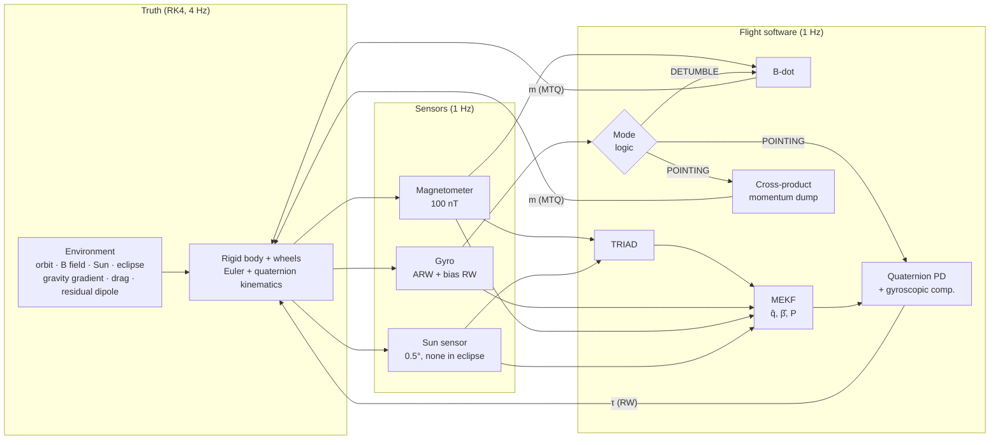

# tumble-to-point

**A compact, validated CubeSat ADCS simulator — from a 10 deg/s tumble to sub-degree nadir pointing.**

B-dot detumbling with magnetorquers → TRIAD initialisation → Multiplicative EKF with gyro-bias estimation → quaternion-feedback PD on reaction wheels with magnetic momentum dumping. Pure NumPy/SciPy/Matplotlib, ~1100 lines of library code, and every claim below is produced by a test or a script in this repo.

<p align="center"></p>

| What | Result (nominal run, `scripts/run_mission.py`) | Verified by |
|---|---|---|
| Torque-free energy / inertial angular momentum, 1 orbit, RK4 @ 0.25 s | rel. drift 7.4e-9 / 2.3e-8 | `tests/test_dynamics.py` |
| RK4 global order (step halving) | error ratio 15.98, 16.00 (theory: 16) | `tests/test_dynamics.py` |
| Quaternion norm | \|q\|−1 ≤ 2.2e-16 | `tests/test_dynamics.py` |
| B-dot from 8.8 deg/s | < 0.5 deg/s in 1.17 orbits | `tests/test_closed_loop.py` |
| MEKF consistency (8-run open-loop MC) | ≥ 98 % inside ±3σ, ANEES ≈ n = 6 | `tests/test_mekf.py` |
| Pointing, last orbit (truth vs LVLH) | p95 0.55 deg (0.32 deg sunlit) | `tests/test_closed_loop.py` |
| Monte Carlo, 50 dispersed runs | see [Monte Carlo](#monte-carlo) | `scripts/monte_carlo.py` |

<!-- TODO(Tommaso): dictate 3-4 lines in your own words -->

## Quick start

```bash
python -m venv .venv && source .venv/bin/activate
pip install -e ".[dev]"
pytest -s                          # the verifier: ~1 min, prints the numbers
python scripts/run_mission.py      # nominal 4-orbit mission -> docs/figures, docs/results.json
python scripts/monte_carlo.py 50   # sequential Monte Carlo -> docs/monte_carlo.json (~8 min)
python scripts/monte_carlo.py --plot-only   # redraw from results/mc_runs.npz
```

Optional: `pip install -e ".[igrf]"` and `SimConfig(field_model="igrf")` to fly the truth through the full IGRF-14 field while the on-board model stays a dipole (model-mismatch study).

## The GNC loop



**Mode logic.** `DETUMBLE` runs B-dot until the gyro-measured rate stays below 0.5 deg/s for 120 s *and* the Sun is visible; TRIAD (magnetometer as anchor, Sun as second vector) then seeds the MEKF and the spacecraft switches to `POINTING` (nadir/LVLH). No sun, no switch: TRIAD needs two non-parallel vectors.

## Models and equations

### Conventions

Scalar-last quaternion $q = [\mathbf{q}_{1:3}^T\ q_4]^T$, attitude matrix $A(q)$ mapping inertial to body components, $\mathbf{b} = A(q)\,\mathbf{r}$, and the product $\otimes$ defined so that $A(q \otimes p) = A(q)A(p)$ (Markley & Crassidis 2014, eqs. 2.82a, 2.125):

$$
A(q) = \left(q_4^2 - \lVert\mathbf{q}_{1:3}\rVert^2\right) I_3 + 2\,\mathbf{q}_{1:3}\mathbf{q}_{1:3}^T - 2 q_4 [\mathbf{q}_{1:3}\times],
\qquad
q \otimes p = \begin{bmatrix} p_4\mathbf{q}_{1:3} + q_4\mathbf{p}_{1:3} - \mathbf{q}_{1:3}\times\mathbf{p}_{1:3} \\ q_4 p_4 - \mathbf{q}_{1:3}\cdot\mathbf{p}_{1:3} \end{bmatrix}
$$

`tests/test_quaternion.py` checks the composition rule on random quaternions and that the quaternion kinematics reproduce $\dot A = -[\boldsymbol\omega\times]A$.

### Attitude dynamics and kinematics

Rigid bus with three orthogonal reaction wheels, $\mathbf{h}_w$ the wheel momentum and $\boldsymbol\tau_w$ the torque the wheels apply *to the bus*:

$$
J\dot{\boldsymbol\omega} = \boldsymbol\tau_{\text{ext}} + \boldsymbol\tau_w - \boldsymbol\omega \times \left(J\boldsymbol\omega + \mathbf{h}_w\right),
\qquad
\dot{\mathbf{h}}_w = -\boldsymbol\tau_w,
\qquad
\dot q = \tfrac{1}{2}\begin{bmatrix}\boldsymbol\omega \\ 0\end{bmatrix} \otimes q = \tfrac12 \Xi(q)\,\boldsymbol\omega
$$

Integrated with classic RK4 (actuator commands zero-order held, disturbances re-evaluated every 0.25 s sub-step) and the quaternion re-projected onto $\lVert q\rVert = 1$ after each step. In the torque-free case the integrator must conserve

$$
T = \tfrac12\boldsymbol\omega^T J \boldsymbol\omega, \qquad \mathbf{H}_I = A(q)^T\left(J\boldsymbol\omega + \mathbf{h}_w\right),
$$

and for an axisymmetric body reproduce $\omega_3 = \text{const}$, $\omega_1 + i\omega_2 = \omega_\perp e^{i\lambda t}$ with $\lambda = (I_3 - I)\,\omega_3 / I$. All three are tested, plus the 4th-order convergence of RK4.

### Orbit and environment

* **Orbit**: circular two-body, 500 km, $i = 97.4^\circ$ (sun-synchronous at that altitude, computed from $J_2$), $\Omega = 0$, epoch 2026-03-20 12:00 UTC (equinox → β ≈ 0°, longest eclipses, ~35 min per orbit). $T \approx 94.6$ min.
* **Geomagnetic field**: centred tilted dipole from the IGRF-13 degree-1 Gauss coefficients $(g_1^0, g_1^1, h_1^1)$, rotated with GMST:

$$
\mathbf{B}(\mathbf{r}) = \left(\frac{R_\oplus}{\lVert\mathbf{r}\rVert}\right)^3 \left[3\left(\mathbf{m}\cdot\hat{\mathbf{r}}\right)\hat{\mathbf{r}} - \mathbf{m}\right], \qquad \mathbf{m} = [g_1^1,\ h_1^1,\ g_1^0]^T \ (\text{ECEF})
$$

* **Sun**: low-precision solar ephemeris (Vallado, Alg. 29). **Eclipse**: cylindrical shadow, $\mathbf{r}\cdot\hat{\mathbf{s}} < 0 \ \wedge\ \lVert\mathbf{r} - (\mathbf{r}\cdot\hat{\mathbf{s}})\hat{\mathbf{s}}\rVert < R_\oplus$.
* **Gravity-gradient torque** (M&C eq. 3.157), with $\mathbf{r}_b = A\mathbf{r}$:

$$
\boldsymbol\tau_{gg} = \frac{3\mu}{\lVert\mathbf{r}\rVert^5}\ \mathbf{r}_b \times \left(J\,\mathbf{r}_b\right)
$$

* **Aerodynamic torque**: flat-plate drag on the 3U box, exponential atmosphere ($\rho_{500} = 6.97\times10^{-13}$ kg/m³, $H = 63.8$ km), centre-of-pressure offset $\mathbf{r}_{cp}$:
  $\boldsymbol\tau_{a} = \mathbf{r}_{cp}\times\left(-\tfrac12\rho C_D A_\perp \lVert\mathbf{v}\rVert^2\hat{\mathbf{v}}_b\right)$, $A_\perp = \sum_i A_i\lvert\hat{\mathbf{n}}_i\cdot\hat{\mathbf{v}}_b\rvert$.
* **Residual magnetic dipole**: $\boldsymbol\tau_{rm} = \mathbf{m}_{res}\times\mathbf{B}_b$, $\lVert\mathbf{m}_{res}\rVert \approx 4\times10^{-3}$ A m².

### Sensors

| Sensor | Model | Default |
|---|---|---|
| Magnetometer | $\tilde{\mathbf{b}} = A\mathbf{B} + \mathbf{b}_0 + \mathbf{v}$ | σ = 100 nT/axis, $\mathbf{b}_0 = 0$ (calibrated) |
| Gyro | Farrenkopf: $\tilde{\boldsymbol\omega} = \boldsymbol\omega + \boldsymbol\beta + \boldsymbol\eta_v$, $\dot{\boldsymbol\beta} = \boldsymbol\eta_u$ | ARW σ_v = 8.7e-5 rad/√s (0.30 °/√h), RRW σ_u = 1e-6 rad/s^1.5, β₀ ~ 0.05 °/s/axis |
| Sun sensor | unit vector + noise, unavailable in eclipse, full-sky FOV | σ = 0.5°/axis |

The gyro is sampled as a delta-angle sensor (rate averaged over the 1 s interval) with the exact discrete noise model of M&C eq. 6.90:
$\boldsymbol\beta_{k+1} = \boldsymbol\beta_k + \sigma_u\sqrt{\Delta t}\,\mathbf{N}_u$,
$\tilde{\boldsymbol\omega}_{k+1} = \bar{\boldsymbol\omega} + \tfrac12(\boldsymbol\beta_{k+1}+\boldsymbol\beta_k) + \left(\sigma_v^2/\Delta t + \sigma_u^2\Delta t/12\right)^{1/2}\mathbf{N}_v$.

### Control

**B-dot** (magnetometer only, no gyro), with the near-optimal gain of Avanzini & Giulietti (2012):

$$
\mathbf{m} = -\frac{k}{\lVert\mathbf{B}\rVert}\,\dot{\hat{\mathbf{b}}}, \qquad k = 2n\,(1 + \sin\xi)\,J_{\min}, \qquad \dot{\hat{\mathbf{b}}}\approx \frac{\hat{\mathbf{b}}_k - \hat{\mathbf{b}}_{k-1}}{\Delta t}
$$

where $n$ is the mean motion and $\xi$ the orbit inclination w.r.t. the geomagnetic equator. Since $\dot{\hat{\mathbf b}} \approx -\boldsymbol\omega\times\hat{\mathbf b}$ for a slowly rotating field, the torque $\mathbf m \times \mathbf B$ is dissipative ($\boldsymbol\omega\cdot\boldsymbol\tau \le 0$, tested). The dipole is saturated at 0.2 A m² per axis by scaling the whole vector, which keeps its direction.

**Pointing**: quaternion feedback PD with gyroscopic compensation (Wie 2008), LVLH target ($\hat{\mathbf z}$ nadir, $\hat{\mathbf y}$ anti-orbit-normal, $\boldsymbol\omega_{ref} = [0, -n, 0]^T$ in LVLH):

$$
\delta q = q\otimes q_{ref}^{-1},\qquad
\boldsymbol\tau_w = -K_p\,\delta\mathbf{q}_{1:3} - K_d\left(\boldsymbol\omega - A(\delta q)\,\boldsymbol\omega_{ref}\right) + \boldsymbol\omega\times\left(J\boldsymbol\omega + \mathbf{h}_w\right),
\qquad K_p = 2\omega_n^2 J,\ K_d = 2\zeta\omega_n J
$$

with $\omega_n = 0.08$ rad/s, $\zeta = 0.9$, sign of $\delta q$ chosen so $\delta q_4 \ge 0$ (shortest path, no unwinding). The controller uses the *estimated* attitude and rate ($\hat{\boldsymbol\omega} = \tilde{\boldsymbol\omega} - \hat{\boldsymbol\beta}$) and the *nominal* inertia. Wheels: 1 mN m, 10 mN m s per axis.

**Momentum dumping** (cross-product law):

$$
\mathbf{m} = \frac{k_d}{\lVert\mathbf{B}\rVert^2}\,\mathbf{h}_w\times\mathbf{B}
\quad\Longrightarrow\quad
\mathbf{m}\times\mathbf{B} = -k_d\left(\mathbf{h}_w - \frac{(\mathbf{h}_w\cdot\mathbf{B})\mathbf{B}}{\lVert\mathbf{B}\rVert^2}\right) = -k_d\,\mathbf{h}_{w,\perp}
$$

Only the component of $\mathbf{h}_w$ perpendicular to $\mathbf{B}$ can be removed at any instant; the field's rotation along the orbit makes all axes reachable over time. $k_d = 5\times10^{-3}$ s⁻¹.

### Estimation: Multiplicative EKF

Following Markley & Crassidis (2014), sec. 6.2 / Table 6.3. The **error state** is

$$
\Delta\mathbf{x} = \begin{bmatrix}\delta\boldsymbol\vartheta \\ \Delta\boldsymbol\beta\end{bmatrix}\in\mathbb{R}^6,
\qquad
q = \delta q(\delta\boldsymbol\vartheta)\otimes\hat q,\quad \delta q(\delta\boldsymbol\vartheta)\approx\begin{bmatrix}\delta\boldsymbol\vartheta/2\\1\end{bmatrix},
\qquad
\boldsymbol\beta = \hat{\boldsymbol\beta} + \Delta\boldsymbol\beta
$$

so the 4-parameter quaternion never enters the covariance (no singular $4\times4$ $P$, no norm constraint in the filter).

**Propagation** with $\hat{\boldsymbol\omega} = \tilde{\boldsymbol\omega} - \hat{\boldsymbol\beta}$, closed-form $\hat q_{k+1} = \Theta(\hat{\boldsymbol\omega}_k)\,\hat q_k$ and

$$
P_{k+1} = \Phi_k P_k \Phi_k^T + G_k Q_k G_k^T,\qquad
\Phi_k = \begin{bmatrix}\Phi_{11} & \Phi_{12}\\ 0_3 & I_3\end{bmatrix},\qquad G_k = \begin{bmatrix}-I_3 & 0_3\\ 0_3 & I_3\end{bmatrix}
$$

$$
\Phi_{11} = I_3 - [\hat{\boldsymbol\omega}\times]\frac{\sin(\lVert\hat{\boldsymbol\omega}\rVert\Delta t)}{\lVert\hat{\boldsymbol\omega}\rVert} + [\hat{\boldsymbol\omega}\times]^2\frac{1-\cos(\lVert\hat{\boldsymbol\omega}\rVert\Delta t)}{\lVert\hat{\boldsymbol\omega}\rVert^2}
$$

$$
\Phi_{12} = [\hat{\boldsymbol\omega}\times]\frac{1-\cos(\lVert\hat{\boldsymbol\omega}\rVert\Delta t)}{\lVert\hat{\boldsymbol\omega}\rVert^2} - I_3\Delta t - [\hat{\boldsymbol\omega}\times]^2\frac{\lVert\hat{\boldsymbol\omega}\rVert\Delta t - \sin(\lVert\hat{\boldsymbol\omega}\rVert\Delta t)}{\lVert\hat{\boldsymbol\omega}\rVert^3}
$$

$$
Q_k = \begin{bmatrix}\left(\sigma_v^2\Delta t + \tfrac13\sigma_u^2\Delta t^3\right)I_3 & -\tfrac12\sigma_u^2\Delta t^2 I_3\\ -\tfrac12\sigma_u^2\Delta t^2 I_3 & \sigma_u^2\Delta t\,I_3\end{bmatrix}
$$

**Update** with each unit-vector measurement $\tilde{\mathbf b} = A(q)\mathbf r + \mathbf v$, processed sequentially (magnetometer, then Sun when lit), $R = \sigma^2 I_3$ (for the magnetometer $\sigma = \sigma_{mag}/\lVert\tilde{\mathbf B}\rVert$):

$$
H_k = \begin{bmatrix}[A(\hat q)\mathbf r\times] & 0_3\end{bmatrix},\quad
K_k = P_k H_k^T\left(H_k P_k H_k^T + R\right)^{-1},\quad
\Delta\hat{\mathbf x} = K_k\left(\tilde{\mathbf b} - A(\hat q)\mathbf r\right)
$$

$$
P_k^+ = (I - K_kH_k)P_k(I - K_kH_k)^T + K_kRK_k^T \ \text{(Joseph)},\qquad
\hat q^+ = \frac{[\delta\hat{\boldsymbol\vartheta}^T/2,\ 1]^T\otimes\hat q}{\lVert\cdot\rVert},\qquad
\hat{\boldsymbol\beta}^+ = \hat{\boldsymbol\beta} + \Delta\hat{\boldsymbol\beta}
$$

**Initialisation** by TRIAD (Black 1964): with $\mathbf{b}_\times = \mathbf b_1\times\mathbf b_2/\lVert\cdot\rVert$,
$A = [\hat{\mathbf b}_1\ \ \mathbf b_\times\ \ \hat{\mathbf b}_1\times\mathbf b_\times]\,[\hat{\mathbf r}_1\ \ \mathbf r_\times\ \ \hat{\mathbf r}_1\times\mathbf r_\times]^T$, magnetometer as anchor (0.2° vs 0.5° noise).

**Consistency criteria.** With $\mathbf e = [\delta\boldsymbol\vartheta^T,\ \Delta\boldsymbol\beta^T]^T$ the true error, $\text{NEES}_k = \mathbf e_k^T P_k^{-1}\mathbf e_k \sim \chi^2_6$ for a consistent filter. Over $M$ independent runs the ANEES must lie in $[\chi^2_{6M}(0.025),\ \chi^2_{6M}(0.975)]/M$ (Bar-Shalom et al. 2001), and each error component must stay inside $\pm3\sigma$ ≥ 95 % of the time.

## Results

All figures come from `scripts/run_mission.py` (seed 1, 4 orbits, initial rate (6, −5, 4) deg/s, random initial attitude). Grey bands are eclipses.

### Detumbling


Rate decays from 8.8 deg/s to the 0.5 deg/s exit threshold in 1.19 orbits. The fast oscillations in the first 0.2 orbits are the free tumble of the elongated 3U body (polhode motion); B-dot removes energy on all axes but slowest about the long axis' perpendiculars, where $J$ is largest. B-dot alone cannot go below ≈ $2n$ (0.13 deg/s) because it nulls the rate *relative to the local field*, which itself rotates twice per orbit.

### Pointing and knowledge error


Once the MEKF is initialised the PD slews ~130° to nadir in ~80 s (< 1° after 77 s). From then on **pointing error tracks knowledge error almost exactly**: control is not the bottleneck, attitude determination is. In sunlight both are ~0.1–0.3°; in eclipse, with the magnetometer as the only vector sensor, rotation about the field line is unobservable instantaneously and is held only by gyro propagation, so the error grows to 1–3° before the Sun returns.

### MEKF error with ±3σ bounds


The covariance "breathes" with the eclipse cycle exactly as the error does: bounds open in the shadow (single-vector observability), collapse at sunrise. Over the nominal run the attitude and bias errors stay inside ±3σ 98.4–99.9 % of the time, mean NEES 5.90 (expected 6).

### Wheel momentum and dumping


Peak wheel momentum 2.1 mN m s during the acquisition slew (21 % of capacity); afterwards the cross-product law holds $\lVert\mathbf h_w\rVert$ below ~0.2 mN m s against gravity-gradient, drag and residual-dipole torques with less than 0.01 A m² of dipole.

### Monte Carlo


50 sequential runs, 3 orbits each. Dispersions: initial rate with random direction and $\lVert\boldsymbol\omega_0\rVert\sim\mathcal U(2,10)$ deg/s, uniformly random initial attitude, true principal inertias ×U(0.9, 1.1) with a random 0–3° principal-axis misalignment (GNC keeps the nominal tensor), residual dipole $\mathcal N(0, (3\times10^{-3})^2)$ A m² per axis, independent sensor-noise and gyro-bias seeds. Left: rate envelope of each run up to its own mode switch. Right: pointing error re-aligned on each run's switch, over the window covered by all runs (the first spike is the acquisition slew).

| Metric (per run → statistic over 50 runs) | median | p95 | max |
|---|---|---|---|
| Detumble time to mode switch [orbits] (mean 1.08) | – | 1.69 | 1.75 |
| Time from MEKF init to < 1° pointing [s] | 79 | 206 | 255 |
| Pointing error p95, last orbit, incl. eclipse [deg] | 0.70 | 1.33 | 1.41 |
| Pointing error p95, last orbit, sunlit [deg] | 0.27 | 0.45 | 0.50 |
| Knowledge error RMS, last orbit [deg] | 0.29 | 0.48 | 0.53 |
| Peak wheel momentum [mN m s] (capacity 10) | 1.87 | 2.88 | 3.12 |

**50/50 runs** detumbled and acquired nadir pointing. Every run meets < 0.5° (p95) in sunlight; a stricter < 1° target including eclipse (the tested requirement is < 2°) is missed by 8 of 50 runs (max 1.41°), which is the single-vector eclipse limit discussed above, not a control problem.

## Design decisions

* **Markley & Crassidis conventions everywhere** (scalar-last, $A(q\otimes p) = A(q)A(p)$, inertial→body). One convention, tested once, avoids the classic Hamilton/JPL sign bugs.
* **MEKF over additive EKF/UKF**: 6-state error representation, no norm constraint, the workhorse of spacecraft attitude estimation since Lefferts, Markley & Shuster (1982).
* **Delta-angle gyro**: the gyro returns the rate averaged over the sample interval, which is what the discrete propagation assumes. Feeding it an instantaneous sample instead would add an unmodelled error of order $\tfrac12\dot\omega\Delta t^2$ per step during slews.
* **Rates**: truth at 4 Hz (RK4), flight software at 1 Hz, as on most CubeSat OBCs. Disturbances are re-evaluated every sub-step; actuator commands are zero-order held.
* **Unit-vector measurements with $R = \sigma^2 I$**: the true measurement noise of a normalised vector lives in the plane ⊥ to it; $\sigma^2 I$ is the standard, slightly conservative approximation (Shuster), and the NEES tests confirm it is not overconfident.
* **GNC uses nominal inertia**, the truth uses a dispersed one in Monte Carlo; the filter's magnetic reference is the dipole even when the truth is IGRF.
* **No numba, no multiprocessing**: a 4-orbit closed-loop run takes ~13 s in plain NumPy on a laptop; Monte Carlo is sequential to keep memory flat.

## Limitations

* **Field model**: tilted dipole. Against full IGRF-14 along this orbit the direction error is 6° median / 35° max and $\lVert\mathbf B\rVert$ is off by up to −42 % (South Atlantic Anomaly); the IGRF frame conversion itself is validated by matching the degree-1 IGRF to the dipole within 0.4° (`tests/test_environment.py`). With `field_model="igrf"` the truth is IGRF while the filter keeps the dipole — this mismatch is *not* modelled in $R$, so expect the filter to become inconsistent (that is the point of the option).
* **No magnetometer/magnetorquer interference**: real systems duty-cycle MTQs and sample the magnetometer with the torquers off.
* **Ideal actuators**: no wheel friction, jitter, speed-dependent torque limits, MTQ dynamics or quantisation; three orthogonal wheels (no redundancy/allocation).
* **Environment**: circular two-body orbit (no $J_2$, no drag decay), exponential atmosphere without solar activity, no solar radiation pressure, no albedo on sun sensors, cylindrical shadow (no penumbra).
* **Sensors**: full-sky sun sensing, no FOV constraints, no misalignment or scale-factor errors, no magnetometer bias estimation.
* **Eclipse pointing**: with one vector sensor the knowledge error in long eclipses reaches 1–3°; a star tracker or an Earth sensor would remove this, and the PD gains are not tuned for it.
* Not flight software: no fault detection, no safe mode, no fixed-point/timing concerns.

## Repository layout

```
src/cubeadcs/
  quaternion.py   algebra, DCM, TRIAD-ready conversions (Shepperd)
  dynamics.py     Euler + wheels + kinematics, RK4
  orbit.py        circular Keplerian orbit, SSO inclination
  environment.py  dipole / IGRF, Sun, eclipse, atmosphere, disturbance torques
  sensors.py      magnetometer, Farrenkopf gyro, sun sensor
  control.py      B-dot, LVLH reference, quaternion PD, momentum dumping, saturation
  estimation.py   TRIAD, MEKF
  sim.py          closed-loop simulation, mode logic, metrics
  plotting.py     figures
tests/            the verifier (pytest)
scripts/          run_mission.py, monte_carlo.py
```

## References

1. F. L. Markley, J. L. Crassidis, *Fundamentals of Spacecraft Attitude Determination and Control*, Springer, 2014. doi:10.1007/978-1-4939-0802-8
2. B. Wie, *Space Vehicle Dynamics and Control*, 2nd ed., AIAA Education Series, 2008.
3. G. Avanzini, F. Giulietti, "Magnetic Detumbling of a Rigid Spacecraft", *Journal of Guidance, Control, and Dynamics*, 35(4), 2012.
4. H. D. Black, "A Passive System for Determining the Attitude of a Satellite", *AIAA Journal*, 2(7), 1964.
5. R. L. Farrenkopf, "Analytic Steady-State Accuracy Solutions for Two Common Spacecraft Attitude Estimators", *Journal of Guidance and Control*, 1(4), 1978.
6. D. A. Vallado, *Fundamentals of Astrodynamics and Applications*, 4th ed., Microcosm Press, 2013.
7. E. J. Lefferts, F. L. Markley, M. D. Shuster, "Kalman Filtering for Spacecraft Attitude Estimation", *Journal of Guidance, Control, and Dynamics*, 5(5), 1982.
8. P. Alken et al., "International Geomagnetic Reference Field: the thirteenth generation", *Earth, Planets and Space*, 73:49, 2021.
9. Y. Bar-Shalom, X. R. Li, T. Kirubarajan, *Estimation with Applications to Tracking and Navigation*, Wiley, 2001.

## License

MIT © 2026 Tommaso Maggiolo. See [LICENSE](LICENSE) and [CITATION.cff](CITATION.cff).
